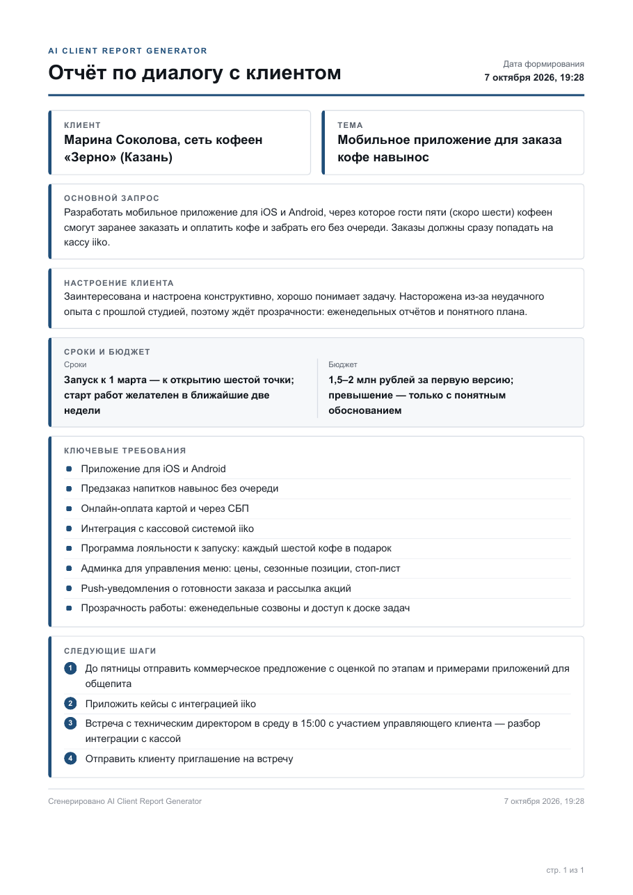

# AI Client Report Generator

Консольная утилита, которая превращает сырую транскрибацию разговора с клиентом в аккуратный PDF-отчёт. ИИ сам извлекает из диалога главное: кто клиент, что он хочет, в каком он настроении, какие сроки и бюджет, ключевые требования и договорённости.

Подходит отделам продаж, агентствам и фрилансерам: после звонка не нужно вручную писать резюме. Достаточно прогнать текст через скрипт.

## Как это работает

```
 текст диалога ──▶ LLM (OpenAI / Anthropic) ──▶ JSON ──▶ HTML (Jinja2) ──▶ PDF (WeasyPrint) ──▶ reports/
```

1. **Ввод.** Текст читается из файла или вставляется в консоль.
2. **ИИ.** Транскрибация уходит в LLM с системным промптом. Провайдер выбирается в `.env`.
3. **JSON.** Ответ проходит надёжный парсинг: снимаются обёртки ` ```json `, вырезается первый `{...}`, проверяются обязательные ключи, отсутствующие заполняются значением «Не указано». Если JSON невалиден, делается одна повторная попытка.
4. **HTML.** Данные и дата формирования подставляются в шаблон `templates/report_template.html`.
5. **PDF.** WeasyPrint превращает HTML в PDF формата A4 и сохраняет его в `reports/report_YYYY-MM-DD_HH-MM-SS.pdf`.

## Структура проекта

```
ai-client-report-generator/
├── main.py                    # точка входа (CLI)
├── templates/
│   └── report_template.html   # HTML-шаблон отчёта (CSS внутри, A4)
├── reports/                   # готовые PDF
├── examples/
│   ├── example_dialog.txt     # пример диалога с клиентом
│   └── example_response.json  # пример ответа ИИ для демо-режима
├── utils/
│   ├── ai_processor.py        # работа с LLM: process_dialog_with_ai(text)
│   ├── pdf_generator.py       # рендер шаблона + HTML → PDF
│   └── logger.py              # логирование в консоль и logs/app.log
├── logs/                      # app.log (не попадает в git)
├── docs/                      # пример отчёта и скриншоты
├── .env.example               # шаблон переменных окружения
├── requirements.txt
└── README.md
```

## Установка

Нужен Python 3.10 или новее.

```bash
git clone https://github.com/<ваш-логин>/ai-client-report-generator.git
cd ai-client-report-generator

python -m venv .venv
source .venv/bin/activate        # Windows: .venv\Scripts\activate

pip install -r requirements.txt
```

### Системные библиотеки для WeasyPrint

WeasyPrint рисует PDF с помощью библиотеки Pango, её нужно поставить отдельно. Подробная инструкция для всех ОС есть в [документации WeasyPrint](https://doc.courtbouillon.org/weasyprint/stable/first_steps.html#installation).

- **Windows.** Установите [MSYS2](https://www.msys2.org/), затем в терминале MSYS2 выполните `pacman -S mingw-w64-x86_64-pango`. Добавьте `C:\msys64\mingw64\bin` в переменную `PATH` (или задайте `WEASYPRINT_DLL_DIRECTORIES=C:\msys64\mingw64\bin`). Проверка: `python -m weasyprint --info`.
- **macOS:** `brew install pango`
- **Ubuntu / Debian:** `sudo apt install libpango-1.0-0 libpangoft2-1.0-0`

## Настройка `.env`

```bash
cp .env.example .env    # Windows: copy .env.example .env
```

Откройте `.env` и впишите ключ выбранного провайдера:

| Переменная | Назначение | По умолчанию |
|---|---|---|
| `AI_PROVIDER` | `openai` или `anthropic` | `openai` |
| `OPENAI_API_KEY` | ключ OpenAI | — |
| `OPENAI_MODEL` | модель OpenAI | `gpt-4o-mini` |
| `ANTHROPIC_API_KEY` | ключ Anthropic | — |
| `ANTHROPIC_MODEL` | модель Anthropic | `claude-sonnet-4-5` |

Файл `.env` указан в `.gitignore` и в репозиторий не попадает. Ключ никогда не пишется в логи.

## Запуск

Из файла:

```bash
python main.py examples/example_dialog.txt
```

Вручную: запустите без аргументов, вставьте текст и завершите ввод пустой строкой.

```bash
python main.py
```

Демо-режим — PDF из готового JSON, без обращения к ИИ и без API-ключа. Удобно, чтобы проверить установку WeasyPrint или поправить шаблон:

```bash
python main.py --from-json examples/example_response.json
```

В конце скрипт напишет:

```
Отчёт успешно создан: reports/report_2026-10-07_19-30-12.pdf
```

### Коды выхода

| Код | Причина |
|---|---|
| `0` | отчёт создан |
| `1` | файл не найден или текст пустой |
| `2` | нет API-ключа, ошибка сети или API |
| `3` | ИИ вернул невалидный JSON даже после повторной попытки |
| `4` | ошибка рендера шаблона или WeasyPrint |

Подробный журнал каждого этапа лежит в `logs/app.log` в формате `время | уровень | модуль | сообщение`.

## Пример ответа ИИ

```json
{
  "client_name": "Марина Соколова, сеть кофеен «Зерно» (Казань)",
  "topic": "Мобильное приложение для заказа кофе навынос",
  "main_request": "Разработать приложение для iOS и Android с предзаказом, онлайн-оплатой, интеграцией с iiko и программой лояльности.",
  "mood": "Заинтересована и настроена позитивно, но насторожена из-за неудачного опыта с прошлой студией.",
  "deadline": "Запуск к 1 марта, к открытию шестой точки",
  "budget": "1,5–2 млн рублей за первую версию",
  "key_requirements": [
    "Приложение для iOS и Android",
    "Онлайн-оплата картой и через СБП",
    "Интеграция с кассой iiko",
    "Программа лояльности к запуску"
  ],
  "next_steps": [
    "Отправить КП с оценкой по этапам до пятницы",
    "Прислать кейсы с интеграцией iiko",
    "Встреча с техническим директором в среду в 15:00"
  ]
}
```

## Результат

Пример готового отчёта: [docs/sample_report.pdf](docs/sample_report.pdf)



Пример собран командой `python main.py --from-json examples/example_response.json`: диалог [examples/example_dialog.txt](examples/example_dialog.txt), разобранный в [examples/example_response.json](examples/example_response.json). При запуске с API-ключом JSON формирует модель, а шаблон и PDF получаются такими же.

Вывод в консоли:

```
2026-10-07 19:28:46 | INFO     | main | Демо-режим: ИИ не вызывается, данные берутся из examples/example_response.json
2026-10-07 19:28:46 | INFO     | main | Чтение файла: examples/example_response.json
2026-10-07 19:28:46 | INFO     | main | Файл прочитан: 1560 символов
2026-10-07 19:28:46 | INFO     | utils.pdf_generator | Шаблон report_template.html отрендерен (6444 символов HTML)
2026-10-07 19:28:46 | INFO     | utils.pdf_generator | Генерация PDF...
2026-10-07 19:28:46 | INFO     | utils.pdf_generator | PDF сохранён: .../reports/report_2026-10-07_19-28-46.pdf
Отчёт успешно создан: reports/report_2026-10-07_19-28-46.pdf
```

Дополнительные скриншоты кладите в `docs/screenshots/`.

## Стек

Python 3.10+, [openai](https://github.com/openai/openai-python), [anthropic](https://github.com/anthropics/anthropic-sdk-python), [Jinja2](https://jinja.palletsprojects.com/), [WeasyPrint](https://weasyprint.org/), [python-dotenv](https://github.com/theskumar/python-dotenv), `logging`.
